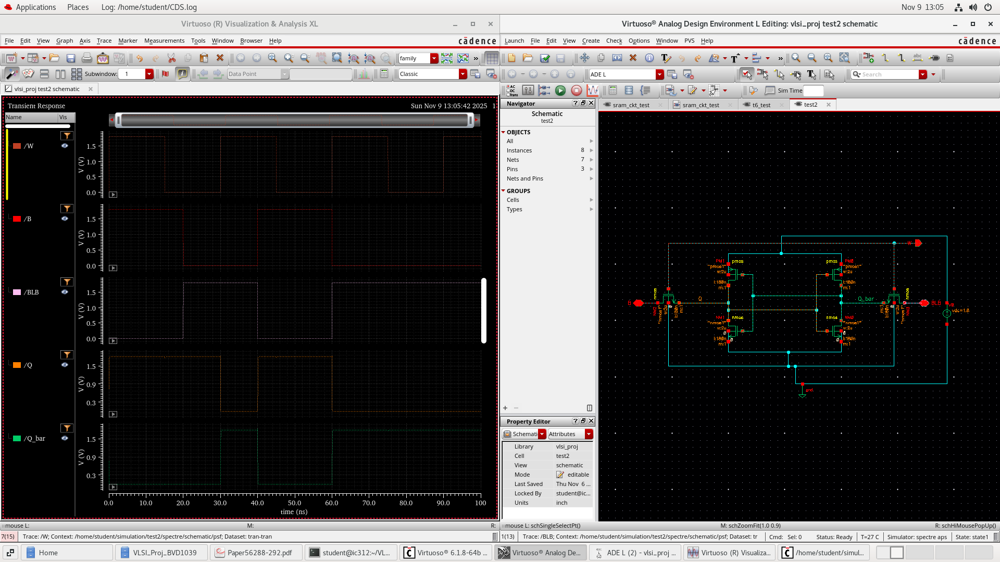
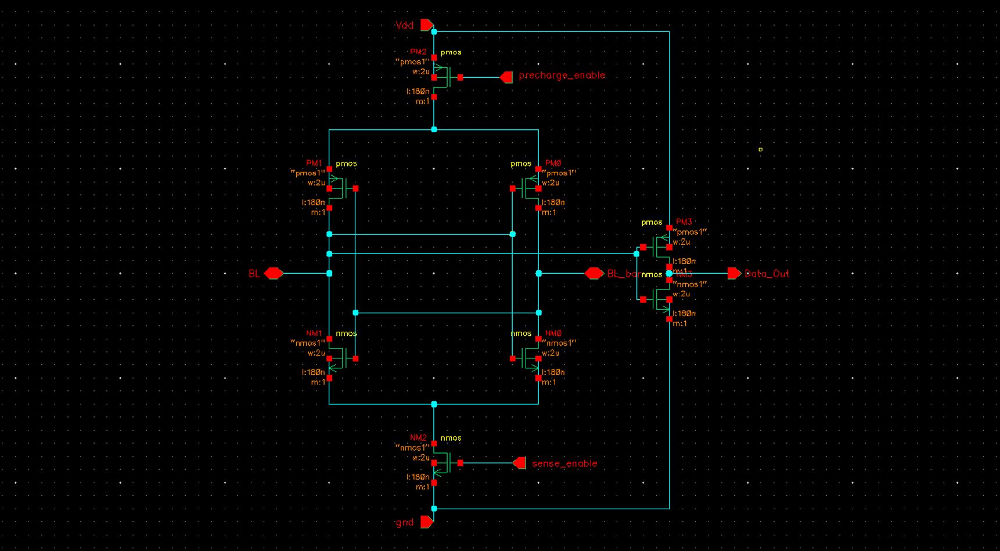
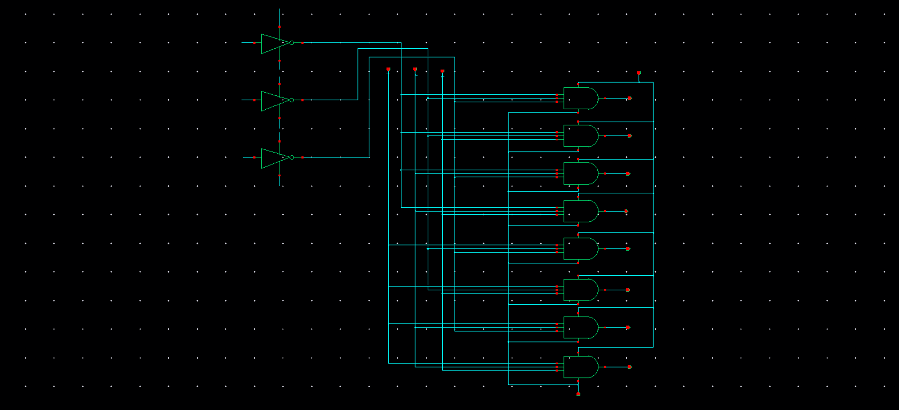
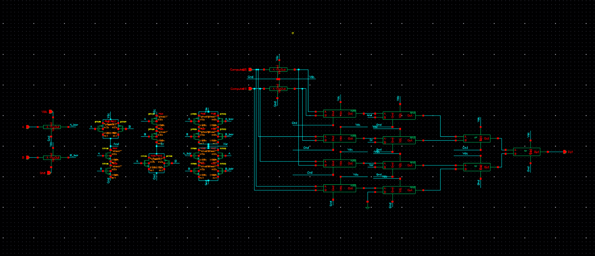
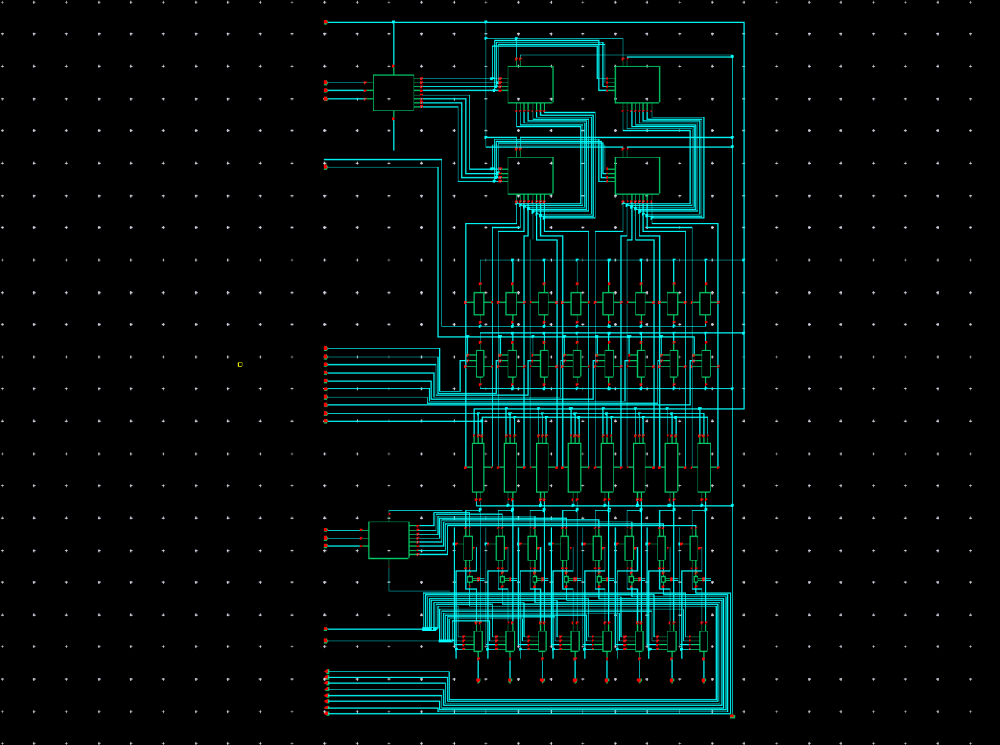

# In-Memory Computing (IMC) Applied on an 8×8 6T SRAM Array

[](LICENSE)
[](https://www.cadence.com)
[](hdl/)
[](docs/project_report.md)

Comparative VLSI design, layout, and simulation of an **8×8 6T SRAM cell array** with embedded **In-Memory Computing (IMC)** capabilities across **180 nm, 90 nm, and 45 nm CMOS** technology libraries in Cadence Virtuoso.

---

## 📌 Architecture Overview

Conventional Von Neumann computing architectures suffer from memory-wall bottlenecks due to frequent data shuttling between processing logic and memory. This project integrates on-chip bitwise compute logic directly at the SRAM periphery using:
1. **Sense-Amplifier Output Latch**: Stores the previous cycle's read bit ($D_{prev}$).
2. **2-Bit Operation Selector Block**: Executes 1-bit Boolean compute operations between current read ($D_{curr}$) and previous read ($D_{prev}$).

### Operation Truth Table

| Selection $S[1:0]$ | Operation | Logic Function | Description |
| :---: | :---: | :---: | :--- |
| `00` | **NAND** | $\overline{D_{curr} \cdot D_{prev}}$ | Bitwise NAND between current and latched read |
| `01` | **NOR** | $\overline{D_{curr} + D_{prev}}$ | Bitwise NOR between current and latched read |
| `10` | **XOR** | $D_{curr} \oplus D_{prev}$ | Bitwise XOR between current and latched read |
| `11` | **Flush** | `1'b0` | Reset / Clear compute output register |

---

## 🖼️ Circuit Schematics & Layout Segments

| Component | Schematic Diagram |
| :--- | :--- |
| **6T SRAM Bit-Cell** |  |
| **Sense Amplifier** |  |
| **Column Decoder (3:8)** |  |
| **Compute Block Logic** |  |
| **Complete Main Circuit** |  |

*Full set of 23 circuit schematics, ADE-L setups, and transient waveforms are available in [`docs/assets/`](docs/assets/) and detailed in [`docs/project_report.md`](docs/project_report.md).*

---

## 📊 Technology Scaling Comparative Analysis

Simulations were performed in Cadence Virtuoso (Spectre ADE-L) across three industrial CMOS technology nodes:

| Metric | 180 nm CMOS | 90 nm CMOS | 45 nm CMOS | Scaling Impact (180nm $\rightarrow$ 45nm) |
| :--- | :---: | :---: | :---: | :---: |
| **Supply Voltage ($V_{DD}$)** | 1.8 V | 1.2 V | 1.0 V | Voltage scaled down by $44.4\%$ |
| **Average Power (mW)** | **35.69 mW** | **16.81 mW** | **0.185 mW** | **$99.48\%$ Power Reduction** |
| **Compute Delay (ns)** | **10.690 ns** | **0.397 ns** | **0.510 ns** | **$>20\times$ Latency Speedup** |

### Key Scaling Findings
- **Power Efficiency**: Transitioning from 180 nm to 45 nm drops average power consumption from **35.69 mW down to 0.185 mW** (a **$99.48\%$ reduction**), enabling ultra-low-power edge AI operations.
- **Delay Dynamics**: Latency improves dramatically from **10.69 ns** (180nm) to **0.397 ns** (90nm). At 45nm, delay slightly shifts to **0.510 ns** due to sub-micron interconnect RC parasitics and threshold voltage headroom constraints.

---

## 📁 Repository Structure

```
.
├── README.md                          # Repository overview and summary
├── LICENSE                            # MIT License
├── CONTRIBUTING.md                    # Guidelines for project contributions
├── .gitignore                         # Cadence, EDA, and system ignore filters
├── docs/                              # Paper documentation & media
│   ├── VLSI_Project_Review.docx       # Original Word research paper
│   ├── project_report.md              # Full Markdown edition of research paper
│   └── assets/                        # High-resolution schematics & waveforms (fig01 - fig23)
├── hdl/                               # Synthesizable/Behavioral Verilog models & testbench
│   ├── sram_6t_cell.v                 # 6T SRAM cell model
│   ├── precharge_equalizer.v          # Precharge & equalizer module
│   ├── write_driver.v                 # Bitline write driver module
│   ├── sense_amplifier.v              # Differential sense amplifier module
│   ├── column_decoder_3to8.v          # 3:8 Column decoder module
│   ├── data_latch.v                   # Sense amplifier output D-latch module
│   ├── imc_compute_block.v            # Compute logic block (NAND, NOR, XOR, Flush)
│   ├── sram_8x8_imc_top.v             # Top-level 8x8 SRAM + IMC macro
│   └── tb_sram_8x8_imc.v              # Comprehensive Verilog testbench
├── spicelib/                          # SPICE / Spectre netlists & PDK simulation setups
│   ├── README.md                      # Cadence Virtuoso ADE-L guide
│   ├── sram_8x8_180nm.sp              # 180nm SPICE netlist template
│   ├── sram_8x8_90nm.sp               # 90nm SPICE netlist template
│   └── sram_8x8_45nm.sp               # 45nm SPICE netlist template
└── simulation/                        # Results & quantitative comparisons
    ├── README.md                      # Detailed power/delay metric summary
    └── results_summary.csv            # Tabular dataset of technology scaling metrics
```

---

## 💻 Running HDL Verilog Simulation

To verify the functional correctness of the 8×8 SRAM IMC architecture with open-source digital simulators (e.g. Icarus Verilog):

```bash
# Compile Verilog HDL models & Testbench
iverilog -o sram_imc_sim.vvp hdl/*.v

# Execute Simulation
vvp sram_imc_sim.vvp
```

---

## 👥 Authors & Credits

This project was conducted as part of the B.Tech. VLSI program at **VIT Chennai**:

- **Vinayak S. Salunke** ([.salunkevinayak2005@gmail.com](mailto:salunkevinayak2005@gmail.com)) — 90nm design & simulation 
- **Subham Prasad Gupta** ([.shubham01dec04@gmail.com](mailto:shubham01dec04@gmail.com)) — Initial research, 180nm design & simulation
- **Jairus S. Solomon** ([.jairus.samraj2023@vitstudent.ac.in](mailto:jairus.samraj2023@vitstudent.ac.in)) — 45nm design & simulation

---

## 📜 License

Distributed under the **MIT License**. See [`LICENSE`](LICENSE) for more details.
