# Comparative Study of In-Memory Computing in an 8×8 6T SRAM Array across 180 nm, 90 nm and 45 nm CMOS Technology Libraries

**Authors:**
- **Subham Prasad Gupta** (B.Tech. VLSI Student at VIT Chennai, `.shubham01dec04@gmail.com`)
- **Jairus S. Solomon** (B.Tech. VLSI Student at VIT Chennai, `.jairus.samraj2023@vitstudent.ac.in`)
- **Vinayak S. Salunke** (B.Tech. VLSI Student at VIT Chennai, `.salunkevinayak2005@gmail.com`)

---

## Abstract

In this work, we present a comparative study of in-memory computing (IMC) implemented within a small-scale static-random-access-memory (SRAM) cell array. We designed an 8×8 bit array using a conventional 6T SRAM cell along with required peripheral circuitry—column decoder, precharge & equalise circuits, write-driver and sense amplifier—targeting three distinct CMOS technology libraries: 180 nm, 90 nm and 45 nm. To enable in-memory computing, we appended a latch at the output of the sense amplifier ($D_{out}$) to retain the previous bit’s value, and implemented a two-bit selection logic block which takes the current $D_{out}$ and the previous $D_{out}$ as inputs and selects one of four operations: **NAND** (`00`), **NOR** (`01`), **XOR** (`10`), or **Flush** (`11`) (i.e., reset/clear). We performed layout-level implementation in Cadence Virtuoso for all three technology nodes, extracted timing and power data, and compared the delay and average power consumption across technology nodes for both standard read/write and the IMC-enabled operations. Our results show the effects of technology scaling on the in-memory compute overhead: while the 45 nm library yields the lowest delay, leakage and dynamic power advantages, the relative overhead of the IMC logic vs. pure memory operations evolves with technology scaling. We discuss the trade-offs of area, power, delay, and reliability in the context of small-scale IMC SRAM, and highlight considerations for architecture-level translation to larger arrays and more complex compute operations.

**Keywords:** 6T SRAM Cell, 45 nm Technology, 90 nm Technology, 180 nm Technology, Cadence Virtuoso, Column Decoder, Compute-in-Memory (CIM), Delay Analysis, In-Memory Computing (IMC), Logic-in-Memory, Low-Power Design, Nanometer CMOS, Power Comparison, Sense Amplifier, SRAM Array, Technology Scaling, VLSI Design, Write Driver.

---

## 1. Introduction

The continuous increase in data-intensive applications such as artificial intelligence (AI), machine learning (ML), and Internet-of-Things (IoT) systems has placed significant emphasis on improving the energy efficiency of computation. Conventional Von Neumann architectures, which physically separate the memory and processing units, suffer from the well-known memory wall — the performance and energy bottleneck caused by frequent data transfer between the processor and memory [1]. To mitigate this limitation, researchers have explored In-Memory Computing (IMC) or Processing-In-Memory (PIM) techniques, where computation is performed directly within or near the memory array [2]. IMC reduces data movement and power consumption, offering a promising approach for accelerating low-precision and logic-based operations.

Among various memory technologies (e.g., DRAM, Flash, RRAM, MRAM), SRAM (Static Random Access Memory) has been widely adopted as a building block for IMC due to its high speed, CMOS compatibility, and stability. The standard 6-transistor (6T) SRAM cell forms the cornerstone of most on-chip memory arrays. A conventional 6T SRAM cell consists of two cross-coupled CMOS inverters forming a bistable latch and two access transistors controlled by the wordline ($WL$) that connect the internal storage nodes to complementary bitlines ($BL$ and $\overline{BL}$) [3]. The typical read, write, and hold operations depend on the balance between access transistor sizing and inverter strength to ensure read stability and write margin.

In a standard SRAM, peripheral circuits such as decoders, precharge and equalization circuits, write drivers, and sense amplifiers are used to support basic memory operations. However, conventional SRAMs do not inherently perform computation; all logic must occur externally in the processor. Integrating simple logic functionality within the SRAM array, without disturbing its read/write integrity, represents the essence of SRAM-based In-Memory Computing [4].

Previous research has demonstrated various approaches to embed computation within SRAM arrays, ranging from bitline voltage manipulation to row-wise operations and modified cell structures such as 8T, 10T, and 12T variants [5]. Yet, these designs often increase area and complexity. A simpler and more compact approach is to retain the standard 6T topology and append minimal external logic at the periphery to enable logic-level operations. This makes it easier to integrate IMC into existing memory architectures while minimizing design overhead.

In this work, we present a 6T SRAM-based In-Memory Computing structure designed as an 8×8 array, simulated in three CMOS technology nodes: 180 nm, 90 nm, and 45 nm. Our design preserves the conventional memory functionality while enabling additional logic operations through a latch and a 2-bit operation select block that can perform NAND, NOR, XOR, and Flush operations between the current and previous memory outputs. By implementing this design in Cadence Virtuoso across multiple technology nodes, we quantitatively assess the effects of technology scaling on power, delay, and performance of the IMC architecture.

---

## 2. Literature Survey

Research in SRAM-based In-Memory Computing (IMC) has evolved rapidly over the past decade, spanning multiple design methodologies, circuit architectures, and target applications.

Lin et al. [1] provided a comprehensive overview of SRAM-based computing-in-memory circuits, categorizing IMC implementations based on digital and analog domains. They highlighted the potential of SRAM cells for performing logic operations, vector-matrix multiplications, and low-precision neural computations, emphasizing the trade-offs between circuit complexity and accuracy.

Mittal et al. [2] conducted an extensive survey of SRAM-based IMC architectures and applications, analyzing the circuit-level and architectural techniques for enhancing speed and power efficiency. Their work demonstrated that conventional 6T SRAM arrays can be extended for Boolean logic functions (e.g., AND, OR, XOR, XNOR) through bitline-based computations, but at the cost of reduced read margins in some cases.

A more recent review by Yoshioka et al. [3] analyzed emerging compute-in-memory circuits and noted that many recent designs exploit peripheral modifications rather than altering the 6T bitcell itself, which aligns closely with the approach followed in our study.

Zhao et al. [4] proposed the DAM SRAM Core, an efficient high-speed compute-in-memory design optimized for binary neural networks. Their architecture employed modified sense amplifier circuits to implement feature extraction and bitwise logic directly within the SRAM, achieving significant reductions in latency and power.

In another related work, Lin et al. [5] demonstrated how technology scaling affects IMC design, showing that as feature sizes shrink, cell stability, leakage power, and variability become critical factors limiting SRAM reliability.

A number of studies also explored 8T and 10T SRAM-based IMC cells [6][7], which provide read-decoupled architectures, improving stability during simultaneous logic and read operations at the cost of larger area overheads. Our work deliberately employs the 6T structure to minimize transistor count.

Furthermore, studies by Lin et al. [8] and Kaushik et al. [9] highlighted how Cadence Virtuoso-based implementations and simulation across multiple technology nodes yield valuable insights into design scaling trends.

---

## 3. Methodology

### 3.1. Design Overview

We started with a standard 6-transistor (6T) SRAM bit-cell (two cross-coupled inverters plus two access transistors) arranged in an 8-row × 8-column array. The peripheral circuits include:
- A column decoder to activate one of the 8 columns during read/write.
- A precharge & equalise circuit for the bit-lines before each access.
- A write driver to drive bit-lines during write operations.
- A sense amplifier to sense the bit-line voltage during reads.

For the IMC functionality, we introduced:
1. **Data Latch**: Placed at the output of each sense amplifier, capturing the previous $D_{out}$ (prior bit-value) and holding it until the next cycle.
2. **Compute Logic Block**: Takes two 1-bit inputs: (current $D_{out}$) and (previous $D_{out}$), and a 2-bit selection input $S[1:0]$:
   - `00` $\rightarrow$ $\text{NAND}(\text{current}, \text{previous})$
   - `01` $\rightarrow$ $\text{NOR}(\text{current}, \text{previous})$
   - `10` $\rightarrow$ $\text{XOR}(\text{current}, \text{previous})$
   - `11` $\rightarrow$ $\text{Flush}$ (reset output to `0`)

### 3.2. Implementation & Simulation

We implemented the entire design (array + peripherals + latch + compute block) in Cadence Virtuoso for three technology libraries: **180 nm**, **90 nm** and **45 nm** CMOS.

---

## 4. Final Circuits, Results and Discussion

### 4.1. 6T SRAM Cell & Array

*Figure 1: 6T SRAM Cell design schematic.*

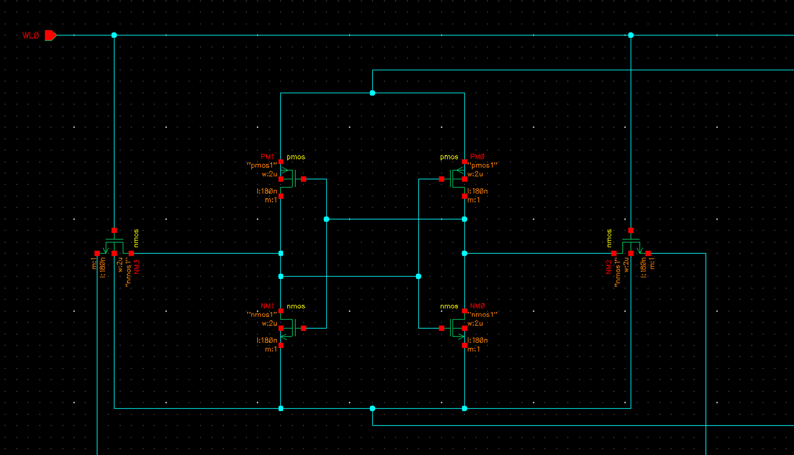
*Figure 2: 6T SRAM Cell transient simulation waveform.*

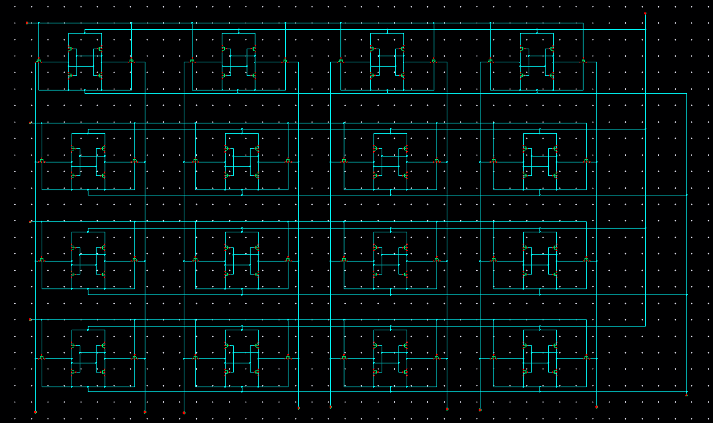
*Figure 3: 4x4 SRAM Array schematic block.*

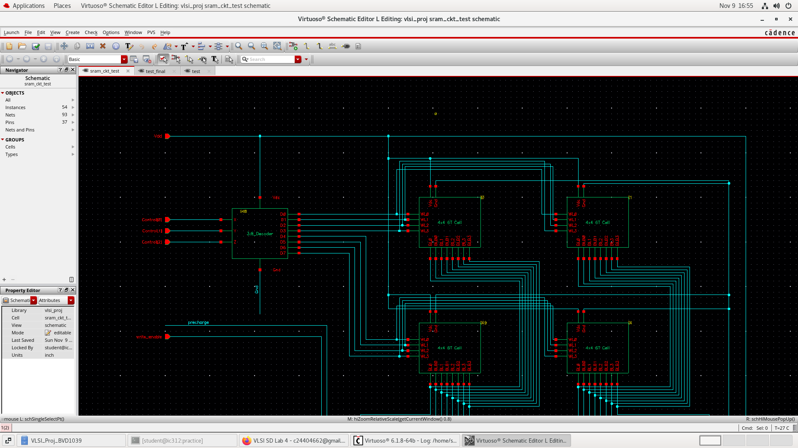
*Figure 4: Symbol of 4x4 array placed in cascade to create the 8x8 SRAM array.*

### 4.2. Precharge & Equalise Circuit

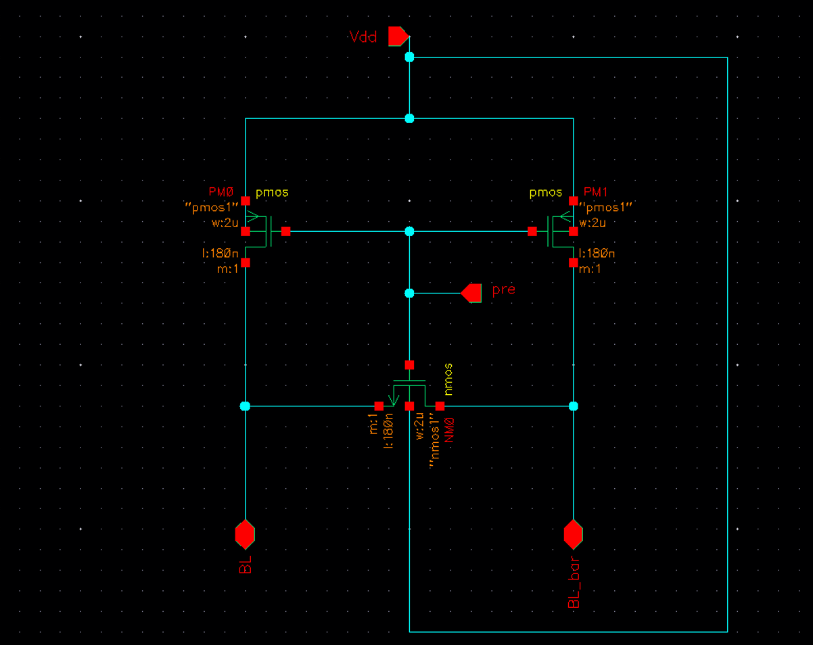
*Figure 5: Precharge & Equalise circuit schematic.*

### 4.3. Write-Driver Circuit

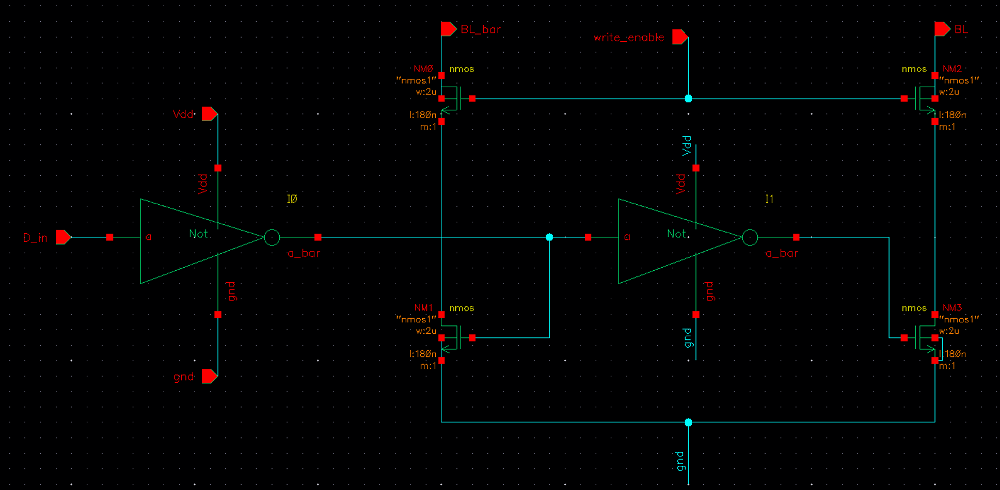
*Figure 6: Write-driver circuit schematic.*

### 4.4. Sense Amplifier

*Figure 7: Differential sense amplifier schematic.*

### 4.5. Column Decoder

*Figure 8: 3-to-8 active-high Column Decoder schematic.*

### 4.6. Compute Block Circuit

*Figure 9: In-Memory Compute block circuit schematic.*

### 4.7. Latch Circuit

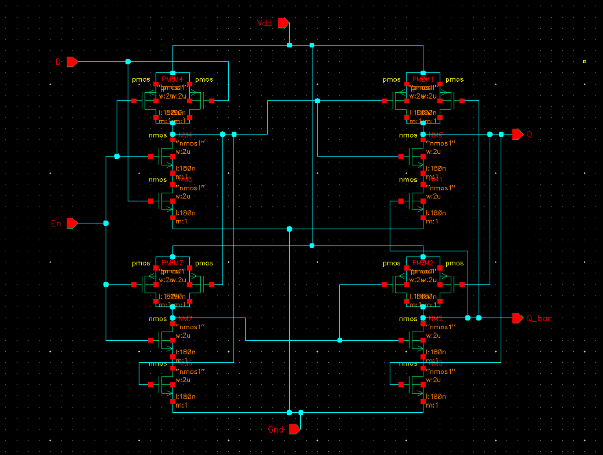
*Figure 10: Data Latch circuit schematic.*

### 4.8. Main Circuit Segments

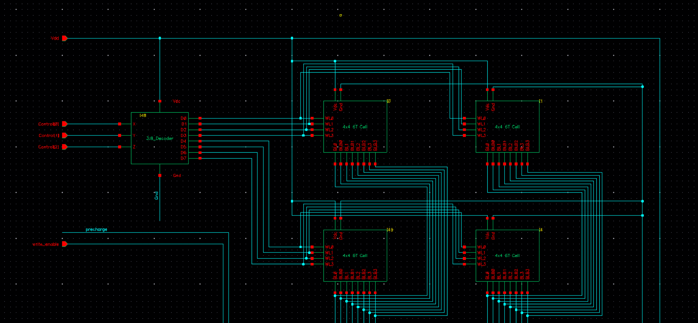
*Figure 11: Segment 1 - 8x8 SRAM Array and Column Decoder.*

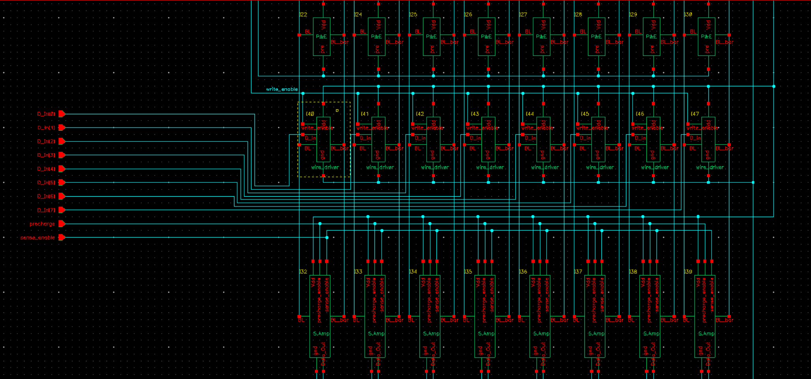
*Figure 12: Segment 2 - Signal stabilizer peripherals and data input.*

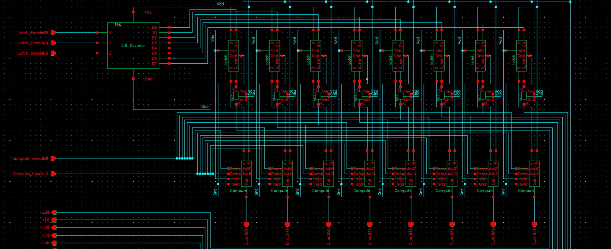
*Figure 13: Segment 3 - Compute block, data latch, and data output.*

*Figure 14: Complete main circuit top-level schematic.*

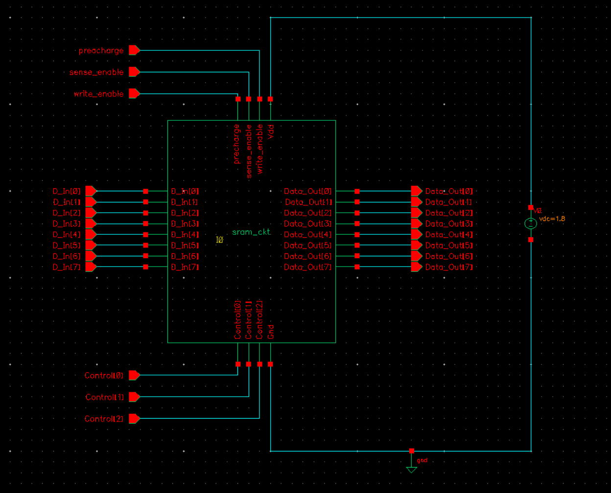
*Figure 15: Symbol representation of the complete 8x8 SRAM IMC circuit.*

### 4.9. Transient Analysis & Waveforms

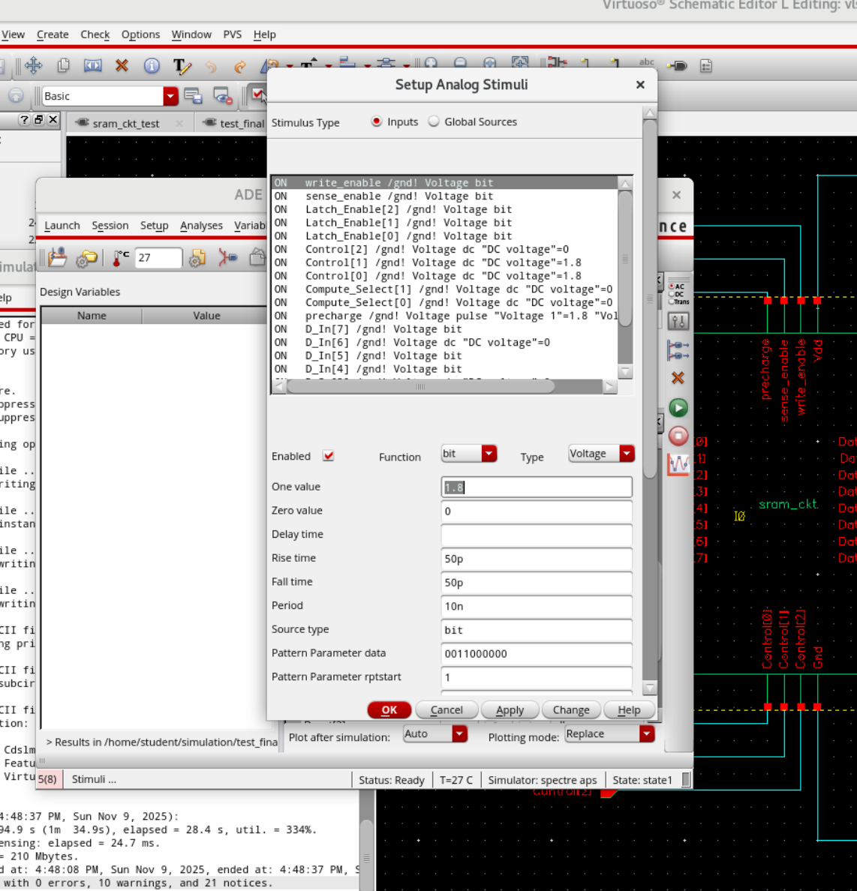
*Figure 16: Cadence Virtuoso ADE-L simulation stimuli setup.*

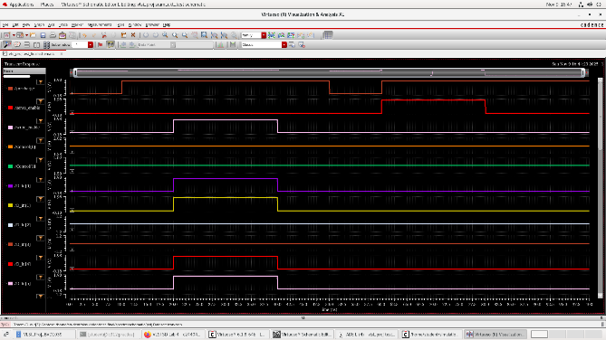
*Figure 17: Transient analysis waveform overview.*

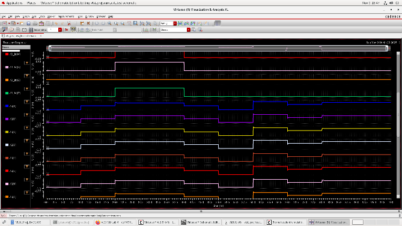
*Figure 18: Transient waveform detail - write/read operation.*

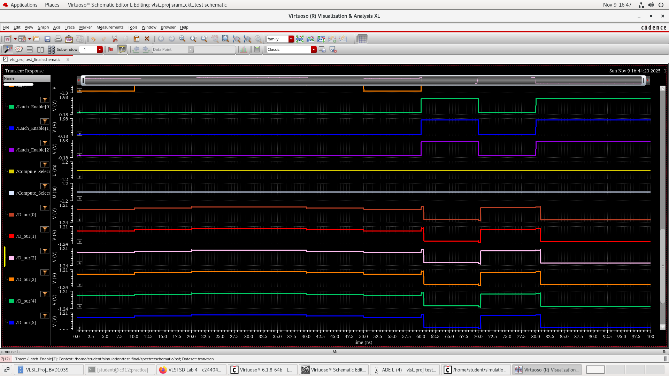
*Figure 19: Transient waveform detail - latch timing.*

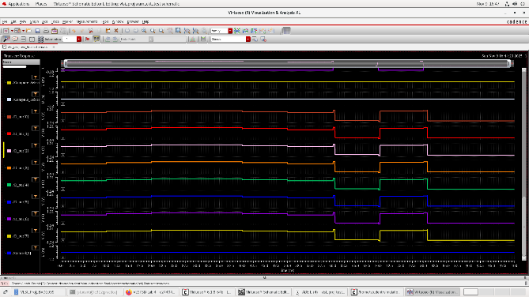
*Figure 20: Transient waveform detail - logic compute operations.*

### 4.10. Technology Node Comparisons & Waveforms

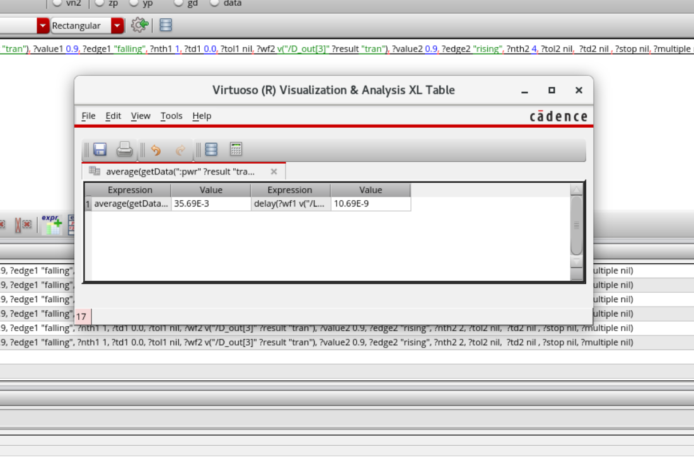
*Figure 21: 180nm Technology Node transient analysis (Avg Power = 35.69 mW, Delay = 10.69 ns).*

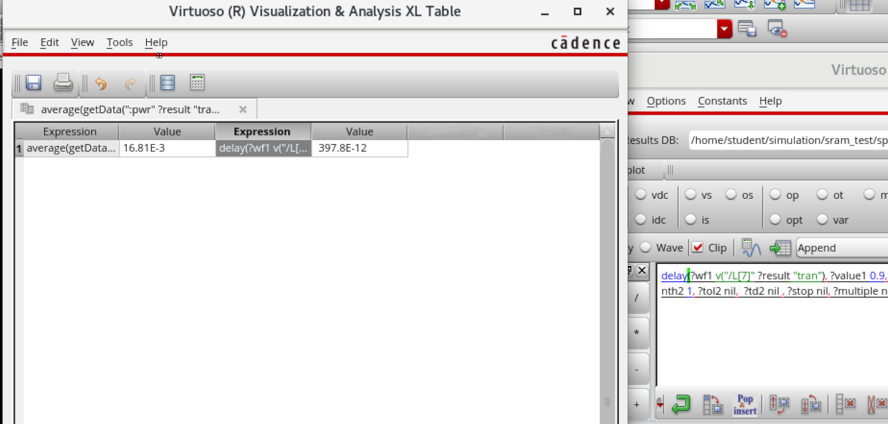
*Figure 22: 90nm Technology Node transient analysis (Avg Power = 16.81 mW, Delay = 0.397 ns).*

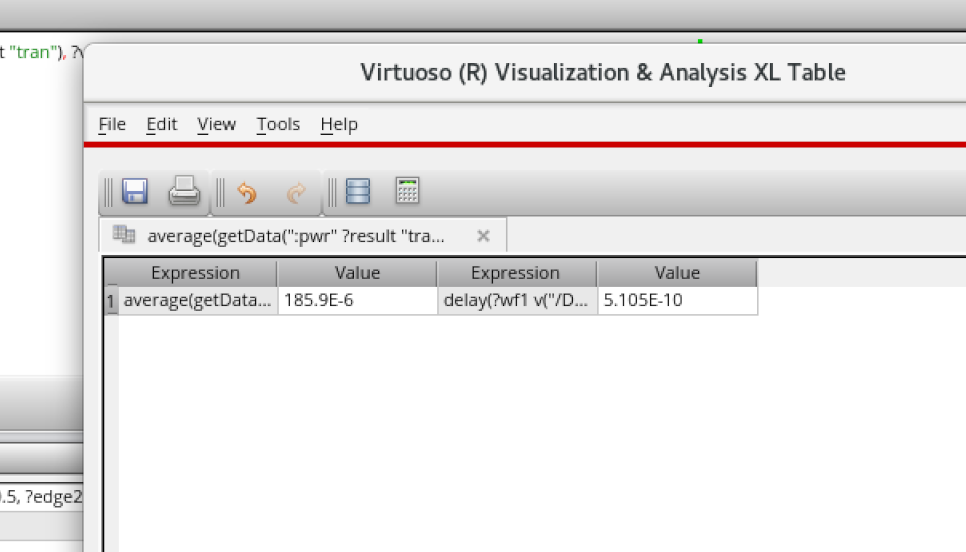
*Figure 23: 45nm Technology Node transient analysis (Avg Power = 0.185 mW, Delay = 0.510 ns).*

### Summary Table of Results

| Technology Library | Average Power (mW) | Latched to Computed Output Delay (ns) | Power Reduction vs 180nm |
| :--- | :---: | :---: | :---: |
| **180 nm CMOS** | 35.69 mW | 10.690 ns | Baseline |
| **90 nm CMOS** | 16.81 mW | 0.397 ns | **52.9%** |
| **45 nm CMOS** | 0.185 mW | 0.510 ns | **99.5%** |

---

## 5. Conclusion

This work presented the design and comparative analysis of an 8×8 6T SRAM cell array with In-Memory Computing (IMC) capability, implemented using three CMOS technology libraries — 180 nm, 90 nm, and 45 nm in Cadence Virtuoso. The design integrated a latch at the sense-amplifier output to retain the previous read value and a compute block capable of performing NAND, NOR, XOR, and Flush operations.

- **Average power** reduced drastically from **35.69 mW (180 nm)** to **16.81 mW (90 nm)** and down to **0.185 mW (45 nm)** (an overall reduction of nearly 99.5%).
- **Computation delay** improved from **10.69 ns at 180 nm** to **0.397 ns at 90 nm**, with a slight shift to **0.51 ns at 45 nm** due to interconnect parasitics and leakage in deep-submicron regimes.

Overall, the 45 nm implementation offers the best power-delay trade-off, achieving two orders of magnitude lower power and more than 20× faster computation compared to the 180 nm baseline.

---

## References

1. Lin, Z.-T., Tong, Z.-Z., Zhang, J., Wang, F.-M., Xu, T., Zhao, Y., Wu, X.-L., Peng, C.-Y., Lu, W.-J., Zhao, Q., & Chen, J. (2022). A review on SRAM-based computing in-memory: Circuits, functions and applications. *Journal of Semiconductors*, 43(3), 031401.
2. Mittal, S., Verma, G., Kaushik, B. K., & Khanday, F. A. (2021). A Survey of SRAM-based In-Memory Computing Techniques and Applications. *Journal of Systems Architecture*, 119, 102276.
3. Yoshioka, K., Ando, S., Miyagi, S., Chen, Y.-C., & Zhang, W. (2024). A Review of SRAM-based Compute-in-Memory Circuits. *arXiv preprint*, arXiv:2411.06079.
4. Zhao, R., Gong, Z., Liu, Y., & Chen, J. (2023). DAM SRAM CORE: An Efficient High-Speed and Low-Power CIM SRAM CORE Design for Feature Extraction Convolutional Layers in Binary Neural Networks. *PMC*, 2023.
5. Lin, Z.-T., et al. (2022). A Review on SRAM-based Computing In-memory Circuits: Technology Scaling and Design Considerations. *Journal of Semiconductors*, 43(3), 031401.
6. “Low-Power 8T SRAM Compute-in-Memory Macro for Edge AI Applications.” *Applied Sciences*, 2022, 14(23), 10924.
7. Kaushik, B. K., & Saini, G. (2019). SRAM-Based In-Memory Computing Architectures: A Survey. *Microelectronics Journal*, 91, 104-118.
8. Lin, Y., & Chen, H. (2020). Analysis of Technology Scaling on SRAM Power and Delay Using Cadence Virtuoso. *IEEE Access*, 8, 54021–54030.
9. Kaushik, B. K., Mittal, S., & Khanday, F. A. (2021). Power-Performance Trade-Offs in CMOS SRAM for In-Memory Computing. *Microprocessors and Microsystems*, 88, 104–117.
